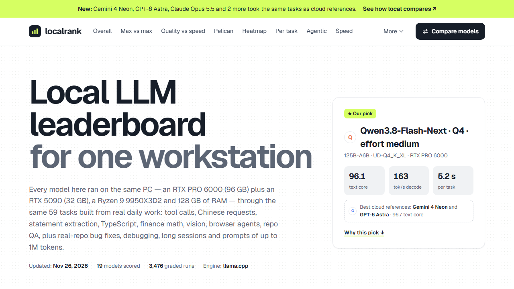

### 🖥️ Local LLM leaderboard

**[wzhaoms.github.io/local-llm-leaderboard](https://wzhaoms.github.io/local-llm-leaderboard/)** benchmarks open-weight LLMs (Qwen, GLM, DeepSeek and more) on one workstation: an RTX PRO 6000 (96 GB), an RTX 5090 (32 GB) and 128 GB of RAM. It measures quality on real work, speed, and prompts of up to 1M tokens, with Claude, GPT and Gemini as cloud references.

#### 🚲 Each lab's strongest model draws a pelican riding a bicycle

Every model got the same prompt: *"Generate an animated SVG of a pelican riding a bicycle."* ([Simon Willison's test](https://simonwillison.net/tags/pelican-riding-a-bicycle/)). Each model's first valid try is below; [every try is on the leaderboard](https://wzhaoms.github.io/local-llm-leaderboard/#pelican).

<table>
  <tr>
    <td align="center" width="33%"> <b>Qwen3.8-Flash-Next</b> Q5 Qwen · local, both GPUs</td>
    <td align="center" width="33%"> <b>GLM-5.3-Flash</b> Q2 Z.ai · local, both GPUs</td>
    <td align="center" width="33%"> <b>DeepSeek-V4.1-Flash</b> Coder DeepSeek · local, RTX PRO 6000</td>
  </tr>
  <tr>
    <td align="center"> <b>Inkling-2-Mini</b> Thinking Machines · local, RTX PRO 6000</td>
    <td align="center"> <b>Claude Opus 5.5</b> Anthropic · cloud, effort high</td>
    <td align="center"> <b>GPT-6 Astra</b> OpenAI · cloud, effort max</td>
  </tr>
  <tr>
    <td align="center"> <b>Gemini 4 Neon</b> Google · cloud, effort xhigh</td>
    <td align="center"> <b>Grok 4.7</b> xAI · cloud, effort medium</td>
    <td align="center"> <b>MAI Code 2</b> Microsoft · cloud, effort max</td>
  </tr>
</table>
